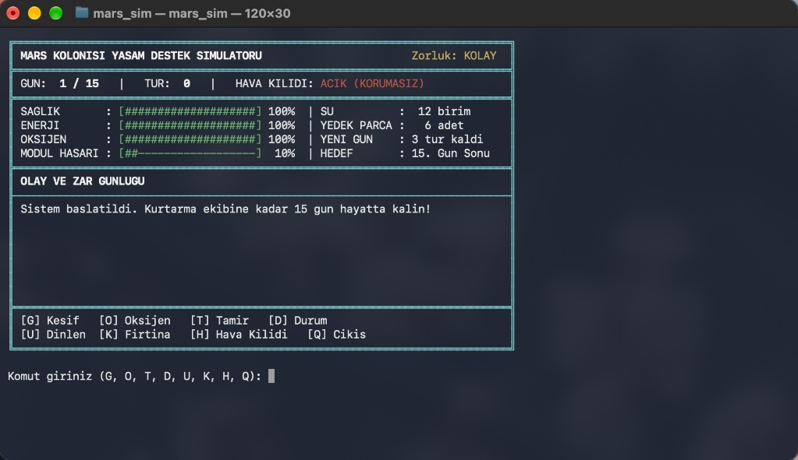

# Mars Kolonisi Yaşam Destek Simülatörü

Standart C (C11) dili ile geliştirilmiş, metin tabanlı ve tek karakterli komutlarla yönetilen hayatta kalma simülatörüdür. Oyuncu, Mars araştırma istasyonunda mahsur kalan bir mühendisi yöneterek kurtarma ekibi ulaşana kadar 15 gün hayatta kalmaya çalışır.



## Özellikler

- **Zorluk Seviyeleri (K, N, Z):** Başlangıç kaynaklarını, keşif başarı eşiklerini ve kum fırtınası süresini belirler.
- **Durum ve Kaynak Yönetimi:** Sağlık, enerji, oksijen, modül hasarı (0-100 aralığında sınırlandırılmış), su, yedek parça ve hava kilidi mühür durumu anlık takip edilir.
- **Zaman ve Gün Akışı:** Geçerli her 3 turda bir yeni güne geçilir; günlük oksijen tüketimi (-8) ve ağır modül hasarı (>70) cezaları uygulanır.
- **Olay ve Zar Günlüğü:** Her adımda üretilen rastgele zar değerleri, başarı eşikleri ve sistem olayları terminal panelinde kayıt altına alınır.
- **Puanlama Sistemi:** Simülasyon sonunda hayatta kalınan gün ve kalan kaynaklara göre toplam puan hesaplanır.

## Kurulum ve Derleme

Projede yalnızca C standart kütüphaneleri (`stdio.h`, `stdlib.h`, `string.h`, `ctype.h`, `time.h`) kullanılmıştır; harici bir bağımlılık bulunmaz.

```bash
git clone [https://github.com/umutckr0/mars_sim.git](https://github.com/umutckr0/mars_sim.git)
cd mars_sim
clang -std=c11 -Wall -Wextra -Wpedantic main-v4.c -o mars_sim

